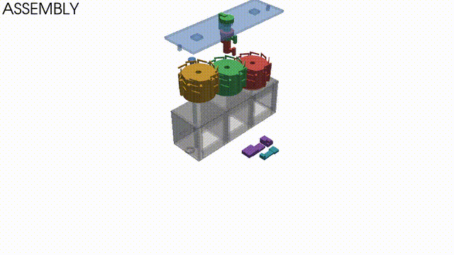

<div align="center">

# ⚙️ Mechanical Counter

**Механический счётчик для 3D-печати — с генерацией STL, анимацией сборки и звуком**

[](https://python.org)
[](LICENSE)
[](https://github.com/USERNAME/mechanical-counter/actions)
[](https://pypi.org/project/mechanical-counter/)



</div>

---

## ✨ Что это

Полный пайплайн для создания **3D-печатного механического счётчика** с тремя разрядами (0–999):

| Возможность | Команда |
|---|---|
| 🖨 **Генерация STL** всех деталей | `mc stl --digits 3` |
| 🎬 **Анимация сборки** (PyVista / matplotlib) | `mc animate --layout lshape` |
| 🔊 **Синхронизированный звук** щелчков | встроен в `animate` |
| 📊 **Прогресс-бар, логи, валидация меша** | везде |
| 🎥 **Split-screen 3 камеры** (изо/фронт/сверху) | `--layout lshape` |
| 🪟 **Прозрачный корпус** при работе | `--no-transparent` откл. |
| 📄 **STEP-экспорт** для CAD | `--step` |

## 🎥 Превью

<table>
<tr>
<td></td>
<td></td>
</tr>
<tr>
<td align="center">Сборка</td>
<td align="center">Работа механизма</td>
</tr>
</table>

## 🚀 Установка

### Быстрая (pip)

```bash
pip install mechanical-counter
```

### Из исходников

```bash
git clone https://github.com/USERNAME/mechanical-counter.git
cd mechanical-counter
pip install -e ".[full]"
```

### Опциональные компоненты

```bash
pip install mechanical-counter[step]    # +cadquery для STEP
pip install mechanical-counter[audio]   # +звук
pip install mechanical-counter[fast]    # +pyvista для быстрого рендера
pip install mechanical-counter[all]     # всё сразу
```

## ▶️ Использование

### Генерация STL

```bash
mc stl --digits 3 --out ./stl
```

Создаст `drum_units.stl`, `drum_tens.stl`, `housing.stl`, `cover.stl`,
`axle.stl`, `pawl.stl`, `ratchet_stop.stl`, `plus_button.stl`,
`reset_button.stl` — готово к слайсингу.

### Анимация

```bash
# Полный шоурил: сборка → работа → разборка
mc animate --digits 3 --layout lshape --out out/showreel.mp4

# Быстрый превью-рендер
mc animate --fast

# Без звука, без split-screen
mc animate --no-audio --layout none

# Только работа механизма до значения 137
mc animate --mode operate --value 137
```

### Программно

```python
from counter import Config
from counter.scene import build_scene
from counter.backend_pv import PVBackend

cfg = Config(digits=3)
parts = build_scene(cfg)

backend = PVBackend(resolution=(1280, 720), fast=False)
backend.add_parts(parts)
backend.reset_camera(distance=200)

img = backend.screenshot()
backend.close()
```

## 🧰 Требования

| Компонент | Обязательно | Для чего |
|---|---|---|
| Python 3.9+ | ✔ | |
| numpy | ✔ | математика |
| numpy-stl | ✔ | экспорт STL |
| tqdm | ✔ | прогресс-бар |
| matplotlib | ○ | fallback-рендер, PNG-превью |
| pyvista + vtk | ○ | **быстрый** 3D-рендер |
| imageio + ffmpeg | ○ | GIF/MP4 |
| cadquery | ○ | STEP-экспорт |
| pillow | ○ | split-screen |

## 🎯 Структура проекта

```
counter/
├── geometry.py    # генерация меша счётчика
├── scene.py       # сцена для анимации
├── cameras.py     # камеры + split-screen
├── audio.py       # синтез звуков
├── backend_pv.py  # PyVista-рендер (быстрый)
├── backend_mpl.py # matplotlib-рендер (fallback)
└── cli.py         # CLI: stl + animate
```

## 🧪 Тесты

```bash
make test           # pytest
make lint           # flake8 + mypy
make format         # black + isort
make ci             # всё вместе
```

## 🖨 Печать и сборка

Смотри [`docs/ASSEMBLY.md`](docs/ASSEMBLY.md) — пошаговая инструкция
с фото, спецификацией материалов и постобработкой.

**Кратко:**
- Материал: **PETG** (пружины, кнопки) + **PLA** (корпус)
- Слой: **0.16 мм**
- Заполнение: **20%** (пружины 40%)
- Поддержки: **выключены**
- Постобработка: сверло Ø4.1 для осей, краска для цифр

## 📖 Документация

- [Архитектура](docs/ARCHITECTURE.md) — как устроен код
- [Сборка](docs/ASSEMBLY.md) — печать и монтаж
- [Спецификация](docs/BOM.md) — список деталей
- [Troubleshooting](docs/TROUBLESHOOTING.md) — VTK, EGL, ffmpeg

## 🤝 Контрибьютинг

PR-ы приветствуются! Смотри [CONTRIBUTING.md](CONTRIBUTING.md).
Баги и идеи — в [Issues](https://github.com/USERNAME/mechanical-counter/issues).

## 📜 Лицензия

MIT — делай что хочешь. Смотри [LICENSE](LICENSE).

## 🙏 Благодарности

- [PyVista](https://pyvista.org) за быстрый 3D
- [numpy-stl](https://github.com/wolph/numpy-stl) за STL
- Всем, кто печатал и присылал фото сборок

<div align="center">

**[⬆ наверх](#-mechanical-counter)**

</div>
